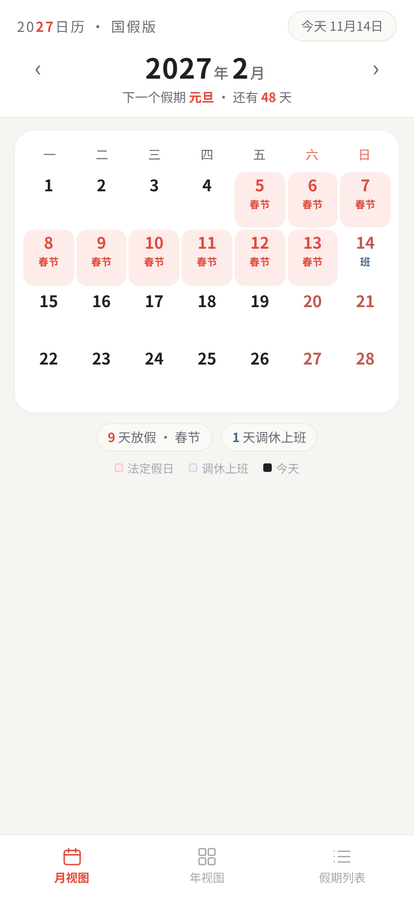
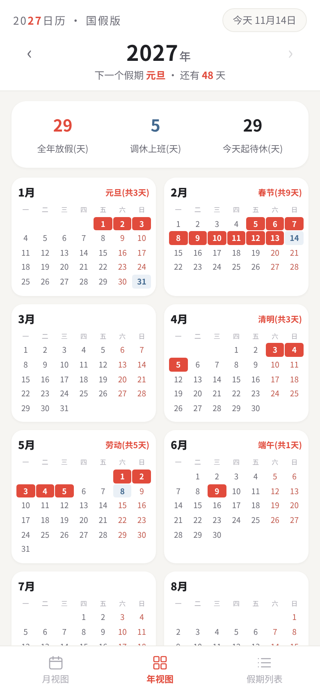
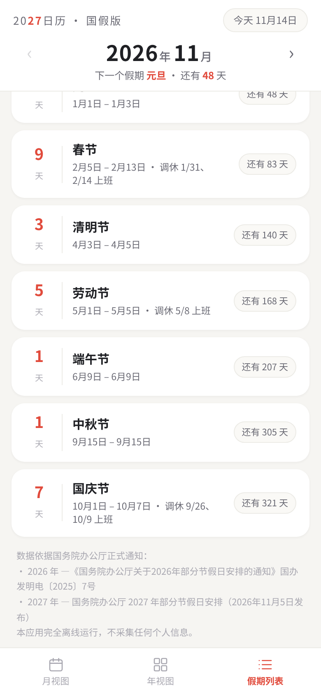

# 2027日历 · Android 中国国假日历

[中文](#中文) | [English](#english)

一个纯离线、零权限的安卓国假日历 App，完整收录 **2026 / 2027 年** 中国法定节假日与调休安排，支持 **按月查看** 与 **按年查看**。

- 安装包：[`2027日历.apk`](2027日历.apk)（49 KB，已签名，Android 5.0+ 通用）
- 技术栈：原生 `Activity` + `WebView` 外壳，界面为单文件 HTML/CSS/JS，数据内置，**无网络权限**
- 构建方式：不需要 Gradle / Android Studio，`./build.sh` 用 `aapt2 + javac + d8 + zipalign + apksigner` 直接出包

## 中文

### 三大视图

| 视图 | 说明 |
| --- | --- |
| **月视图** | 周一起始的日历网格。放假日整段标红并标注假期名，调休上班日标蓝「班」，周末用暖红字，今天用深色胶囊高亮；底部汇总本月「放假 N 天 / 调休 M 天」 |
| **年视图** | 12 个月缩略卡（2 列 × 6 行）一屏看全年：红块=放假、蓝块=调休上班、勾框=今天；顶部三组统计（全年放假天数 / 调休上班天数 / 今天起待休天数） |
| **假期列表** | 顶部红色头卡显示「下一个法定假期 + 倒计时」，下方按年逐条列出：天数、起止日期、调休上班日、当前状态（还有 N 天 / 放假中第 n/x 天 / 已结束） |

页面顶部常驻「下一个假期 · 还有 N 天」倒计时，右上角「今天」按钮一键回到当月。

### 界面预览

| 月视图 | 年视图 | 假期列表 |
| --- | --- | --- |
|  |  |  |

### 内置数据

数据全部来自国务院办公厅正式通知，非估算。

**2027 年**（2026-11-05 发布）

| 节日 | 放假 | 天数 | 调休上班 |
| --- | --- | --- | --- |
| 元旦 | 1/1 – 1/3 | 3 | — |
| 春节 | 2/5 – 2/13 | 9 | 1/31、2/14 |
| 清明节 | 4/3 – 4/5 | 3 | — |
| 劳动节 | 5/1 – 5/5 | 5 | 5/8 |
| 端午节 | 6/9 | 1 | — |
| 中秋节 | 9/15 | 1 | — |
| 国庆节 | 10/1 – 10/7 | 7 | 9/26、10/9 |

合计：放假 **29 天**，调休上班 **5 天**。

**2026 年**（国办发明电〔2025〕7号）：元旦 1/1–1/3（1/4 上班）；春节 2/15–2/23（2/14、2/28 上班）；清明 4/4–4/6；劳动节 5/1–5/5（5/9 上班）；端午 6/19–6/21；中秋 9/25–9/27；国庆 10/1–10/7（9/20、10/10 上班）。合计放假 **33 天**，调休上班 **6 天**。

### 安装

1. 下载 [`2027日历.apk`](2027日历.apk) 并传到安卓手机；
2. 点击安装，若提示「未知来源应用」，按系统提示允许一次即可；
3. 桌面出现「2027日历」图标，打开即用。

兼容 Android 5.0（API 21）及以上，竖屏，不申请任何权限。

### 项目结构

```
2027日历.apk                 已签名成品，可直接安装
2027日历-源码/
├── AndroidManifest.xml     包名 com.cal2027.app，minSdk 21 / targetSdk 34
├── assets/index.html       全部界面与数据（单文件 HTML+CSS+JS）
├── java/com/cal2027/app/MainActivity.java   WebView 外壳、状态栏配色、返回键处理
└── res/                    应用名、主题、五套密度启动图标
预览图/                      各视图效果图
build.sh                     一键构建脚本（无需 Gradle）
使用说明.md                   详细中文使用与改造说明
```

### 自行构建 / 修改

```bash
./build.sh          # 输出 2027日历.apk
```

依赖：JDK 17 与 Android SDK（`build-tools;34.0.0` + `platforms;android-34`）。脚本会在首次运行时生成签名证书 `build/cal2027.keystore`（口令均为 `cal2027`），**证书仅保存在本地、未纳入版本库**，后续升级请沿用同一证书。

修改节假日只需编辑 `2027日历-源码/assets/index.html` 顶部的 `DATA` 对象；新增年份时同步在 `YEARS` 数组里追加。

### 隐私

不联网、不申请权限、不采集任何数据，节假日信息全部写死在本地资源中。

### 许可

MIT License。节假日安排以中国政府网发布的国务院办公厅通知为准，本应用仅供个人查阅。

---

## English

An offline-first Android calendar app for **Chinese public holidays**, covering the full schedules of **2026 and 2027**, with month and year views. Zero permissions, no network access.

- APK: [`2027日历.apk`](2027日历.apk) — 49 KB, signed, works on Android 5.0+
- Stack: native `Activity` + `WebView` shell; the UI is a single HTML/CSS/JS file with data baked in
- Build: no Gradle / Android Studio required — `./build.sh` runs `aapt2 + javac + d8 + zipalign + apksigner`

### Views

| View | Description |
| --- | --- |
| **Month** | Monday-first grid. Holiday ranges are shaded red and labelled with the festival name; make-up workdays (调休) are marked with a blue 「班」 tag; weekends use warm red numerals; today gets a dark pill. Footer summarises the month's holiday and make-up-work days |
| **Year** | Twelve mini-month cards (2 columns × 6 rows) for the whole year: red = holiday, blue = make-up workday, outline = today. Three stats on top: total holiday days / make-up workdays / days still to come |
| **Holiday list** | A red hero card shows the next holiday with a countdown; below, every holiday is listed with duration, date range, make-up workdays and status (in N days / day n of x / ended) |

### Data

All schedules follow official State Council notices (see the Chinese section for the full tables):

| Holiday | 2027 | Days | Make-up workdays |
| --- | --- | --- | --- |
| New Year's Day | Jan 1 – Jan 3 | 3 | — |
| Spring Festival | Feb 5 – Feb 13 | 9 | Jan 31, Feb 14 |
| Qingming | Apr 3 – Apr 5 | 3 | — |
| Labour Day | May 1 – May 5 | 5 | May 8 |
| Dragon Boat | Jun 9 | 1 | — |
| Mid-Autumn | Sep 15 | 1 | — |
| National Day | Oct 1 – Oct 7 | 7 | Sep 26, Oct 9 |

2027 totals: **29** holiday days, **5** make-up workdays. 2026 totals: **33** holiday days, **6** make-up workdays.

### Install

Download `2027日历.apk`, transfer it to an Android phone, tap to install and allow "install from unknown sources" once. Portrait only, no permissions requested.

### Build

```bash
./build.sh
```

Requires JDK 17 and Android SDK (`build-tools;34.0.0`, `platforms;android-34`). A signing keystore is generated on first run at `build/cal2027.keystore` (password `cal2027`); it stays local and is **not** committed — reuse it for future upgrades.

To change the data, edit the `DATA` object at the top of `2027日历-源码/assets/index.html` and add the year to the `YEARS` array.

### Privacy

No network, no permissions, no telemetry. All holiday data ships inside the APK.

### License

MIT. Holiday arrangements follow the State Council notices published by gov.cn; the app is for personal reference only.
